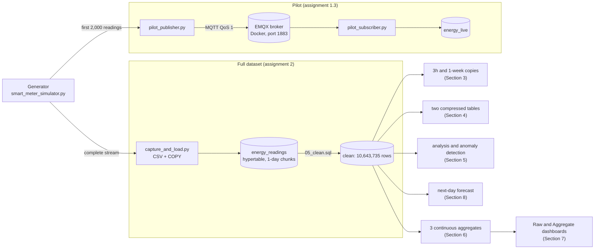

<h1 align="center">Smart Energy Grid Analytics</h1>

<p align="center">
Time-series pipeline, storage benchmarking, dashboards and next-day demand forecasting<br>
for 4,000 smart meters, built with PostgreSQL, TimescaleDB, EMQX (MQTT) and Python.
</p>

<p align="center">
  
  
  
  
  
</p>

**Course:** Advanced Big Data Analytics, Adventist University of Central Africa (AUCA)<br>
**Assignment:** Assignment I, Smart Energy Grid Analytics (issued 1 October 2026, due 15 October 2026)<br>
**Repository:** https://github.com/erneste-uwimpuhwe/Advanced-Big-Data-Analytics-Assignment-I-Smart-Energy-Grid-Analytics

---

## Table of contents

1. [Overview](#1-overview)
2. [Key results](#2-key-results)
3. [Architecture](#3-architecture)
4. [Repository structure](#4-repository-structure)
5. [Prerequisites](#5-prerequisites)
6. [Installation and configuration](#6-installation-and-configuration)
7. [Quick start: the pilot check](#7-quick-start-the-pilot-check)
8. [Full execution guide](#8-full-execution-guide)
9. [Running the dashboards](#9-running-the-dashboards)
10. [Benchmarking protocol](#10-benchmarking-protocol)
11. [Regenerating the dataset](#11-regenerating-the-dataset)
12. [Script reference](#12-script-reference)
13. [SQL reference](#13-sql-reference)
14. [Database schema](#14-database-schema)
15. [Verification checklist](#15-verification-checklist)
16. [Troubleshooting](#16-troubleshooting)
17. [Security and secrets](#17-security-and-secrets)
18. [Deliverables](#18-deliverables)
19. [Team](#19-team)
20. [Academic integrity](#20-academic-integrity)

---

## 1. Overview

An electricity utility records **4,000 smart meters** in **10 regions** (400 per region). Each meter reports
every **15 minutes** from **1 to 28 September 2026 (CAT)**, a planned total of **10,752,000 readings**.
The supplied generator `src/smart_meter_simulator.py` produces the data in memory, with deliberate imperfections:
about 1 % of readings never arrive, about 0.5 % arrive twice, about 2 % arrive late and 40 abnormal consumption
events are injected. The generator is used **unchanged**.

The project answers five questions:

| # | Question | Report sections |
|---|---|---|
| 1 | How should the readings be ingested and stored so that they are complete, consistent and fast to query? | 1, 2 |
| 2 | Which chunk interval and which compression strategy suit the utility's queries best? | 3, 4 |
| 3 | What do the data show about demand, regions, customer types, reporting quality and abnormal consumption? | 5 |
| 4 | How much faster can reporting be with stored summaries, and what does it cost in storage and freshness? | 6, 7 |
| 5 | Can next-day hourly regional demand be forecast more accurately than with a simple baseline? | 8 |

---

## 2. Key results

All numbers below are produced by the programs in this repository and are documented, with screenshots, in the report.

| Area | Result |
|---|---|
| Pilot stream (MQTT, QoS 1) | 2,000 readings at every stage: generator, broker acknowledgement, subscriber and database. The first run lost 196 messages to a full broker queue; the subscriber was corrected and the pilot repeated |
| Full load | 10,696,848 readings loaded (CSV, then `COPY`) in 323.6 s; generator, file and database counts agree |
| Data quality | Completeness 98.9931 %; 108,265 missing, 213,090 delayed and 53,113 duplicate readings; 10,643,735 unique readings after cleaning |
| Chunk intervals | 3 hours (225 chunks), 1 day (29 chunks), 1 week (5 chunks): one-day chunks chosen as the best compromise |
| Compression | Time-ordered compression: 1,343.7 MB to 438.7 MB (ratio 3.06, 67.35 % saved) |
| Demand | Highest 15-minute demand 7,993.7 kW (Monday 28 September, 13:00); weekends about 21 % lower; growth about 2 % per week |
| Customer mix | Industrial meters are 10.2 % of meters but use 57.6 % of the energy |
| Abnormal consumption | 40 of 40 injected events detected, 0 false flags |
| Dashboards | Aggregate dashboard 7.1 times faster than Raw (median 1,117.8 ms against 7,956.9 ms) for 18.03 MB and a one-off 335.7 s refresh |
| Forecast | Ridge regression MAE 4.549 kWh against 42.708 kWh for the previous-day baseline (89.3 % lower) |

---

## 3. Architecture



**Components**

| Component | Role |
|---|---|
| PostgreSQL 18.6 (native Windows service) | Stores all tables and views; database `smart_grid` on tablespace `d_space` (drive D:) |
| TimescaleDB 2.30.2 | Hypertables, compression, continuous aggregates and background jobs |
| EMQX 6.3.1 in Docker (container `emqx`) | MQTT broker: port 1883 for MQTT, port 18083 for the web dashboard |
| Python 3.13 and a virtual environment | All programs (psycopg2, paho-mqtt, pandas, numpy, scikit-learn, matplotlib, Dash) |
| Dash | The two dashboards, served locally on port 8050 |

---

## 4. Repository structure

```
.
├── README.md                  this file
├── requirements.txt           Python packages (pip freeze of the environment used)
├── .gitignore                 excludes venv/, data/, caches and secrets
├── .gitattributes             keeps the generator's line endings untouched
├── src/
│   ├── smart_meter_simulator.py   supplied generator, UNCHANGED
│   ├── db_config.py               shared connection settings (password from PGPASSWORD)
│   ├── load_meters.py             1.2   fill the meters table
│   ├── pilot_publisher.py         1.3   MQTT publisher (first 2,000 readings)
│   ├── pilot_subscriber.py        1.3   MQTT subscriber into energy_live
│   ├── capture_and_load.py        2.1   full stream to CSV, then COPY
│   ├── benchmark.py               3.2, 4.3   five-workload benchmark
│   ├── compress_load.py           4.1   load and compress chunk by chunk
│   ├── improvement.py             4.3   percentage improvement table
│   ├── analysis_5_1.py            5.1   demand patterns
│   ├── analysis_5_2.py            5.2   regions and customer types
│   ├── analysis_5_3.py            5.3   completeness and late data
│   ├── anomaly_5_4.py             5.4   abnormal consumption
│   ├── freshness_6_2.py           6.2   continuous aggregate freshness test
│   ├── dashboard_app.py           7     Raw and Aggregate dashboards
│   ├── dashboard_queries.py       7     panel SQL for both modes
│   ├── dashboard_verify.py        7.3   compare both dashboards numerically
│   ├── dashboard_timing_summary.py 7.4  median, minimum, maximum and speed-up
│   ├── forecast_8.py              8     baseline and Ridge forecast
│   └── assets/                    dashboard style sheet
├── sql/                       numbered SQL scripts (see section 13)
├── results/                   logs, CSV and JSON measurements; results/charts/ for charts
└── data/                      generated CSV (created locally, NOT in the repository)
```

---

## 5. Prerequisites

| Requirement | Details |
|---|---|
| Operating system | Windows 11. Commands in this guide are for **Command Prompt** (not PowerShell) |
| PostgreSQL | 18.x, running as the service `postgresql-x64-18`; user `postgres` |
| TimescaleDB | 2.10 or later (2.30.2 used), installed for that PostgreSQL version |
| Docker Desktop | To run the EMQX container |
| EMQX | 6.3.1, container named `emqx`, port 1883 published (the web dashboard uses 18083) |
| Python | 3.13 with `venv` and `pip` |
| Browser | Edge or Chrome, for the dashboards |
| Disk space | About 10 GB free (the generated CSV is large) |
| Memory | 8 GB RAM was used; close other heavy programs during benchmarks |

---

## 6. Installation and configuration

### 6.1 Get the code

```
git clone https://github.com/erneste-uwimpuhwe/Advanced-Big-Data-Analytics-Assignment-I-Smart-Energy-Grid-Analytics.git D:\auca_a1
cd /d D:\auca_a1
mkdir data results results\charts
```

If your folder is not `D:\auca_a1`, change the constant `CSV_PATH` near the top of `src\capture_and_load.py`.

### 6.2 Python environment

```
python -m venv venv
venv\Scripts\activate
pip install -r requirements.txt
```

`paho-mqtt` **2.x** is required: the MQTT programs use `mqtt.CallbackAPIVersion.VERSION2`.

### 6.3 Connection settings (no password in files)

`src\db_config.py` reads the connection settings from environment variables. Run this in **every new Command Prompt
window**, because Windows does not keep them between windows:

```
cd /d D:\auca_a1
prompt $D $T $P$G
venv\Scripts\activate
set PATH=C:\Program Files\PostgreSQL\18\bin;%PATH%
set PGPASSWORD=your_password
cls
```

| Variable | Default | Meaning |
|---|---|---|
| `PGPASSWORD` | `your_password` (placeholder) | Password of the `postgres` user. **Replace it with your own** |
| `PGHOST` | `localhost` | Database host |
| `PGPORT` | `5432` | Database port |
| `PGDATABASE` | `smart_grid` | Database name |
| `PGUSER` | `postgres` | Database user |

`prompt $D $T $P$G` makes every prompt show the date and time, which the assignment's screenshots require.
`cls` clears the screen so the password line is not visible.

### 6.4 Create the database (once)

Create the folder for the tablespace and run the setup script as the `postgres` user:

```
mkdir D:\pgdata
psql -U postgres -f sql\01_setup.sql
psql -U postgres -d smart_grid -f sql\01_check.sql
```

`sql\01_setup.sql` creates the tablespace `d_space` (folder `D:\pgdata`, so the data live on drive D:), the database
`smart_grid` on it, sets the database time zone to `Africa/Kigali` (CAT) and enables the `timescaledb` extension.
On a machine with plenty of space on drive C:, the tablespace is optional: remove the first line and
`TABLESPACE d_space` from the second. `sql\01_check.sql` shows the database, the extension and the time zone.

### 6.5 Start the MQTT broker

Start Docker Desktop and wait until it is running, then:

```
docker start emqx
docker exec emqx emqx ctl status
```

The second command must report that the node (version 6.3.1) is started. If the container does not exist yet, create it
once from the EMQX image of that version, publishing port 1883 (MQTT) and, optionally, 18083 (web dashboard), and name it `emqx`.

---

## 7. Quick start: the pilot check

This verifies the whole messaging pipeline in about two minutes (assignment 1.3 and 9.2). Use **two** Command Prompt
windows, each prepared with the block in section 6.3.

**Window A: subscriber (start first, wait for `READY`)**

```
python src\pilot_subscriber.py
```

It empties `energy_live`, connects to the broker, subscribes to `energy/meters/#` at QoS 1 and prints `READY`.

**Window B: publisher (after `READY`)**

```
python src\pilot_publisher.py
```

**Expected result**

| Program | Output |
|---|---|
| Publisher | 2000 dictionaries taken (1994 unique, 6 deliberate duplicates), 0 publish errors, 2000 messages acknowledged, 2000 PUBACK callbacks |
| Subscriber (about 15 s later) | 2000 received, 0 redelivered, 0 mismatches, 0 parse errors, 0 insert errors, 2000 rows inserted, 2000 rows in `energy_live` |

Independent database check:

```
psql -U postgres -d smart_grid -c "SELECT count(*) AS rows, count(DISTINCT (meter_id, event_time)) AS unique_pairs FROM energy_live;"
```

Expected: **2000** rows and **1994** unique pairs. Logs are written to `results\pilot_publisher.log` and
`results\pilot_subscriber.log`. The subscriber stops by itself after 15 seconds without a message.
If fewer than 2,000 messages arrive, close other programs, run `docker restart emqx` and repeat.

---

## 8. Full execution guide

Run every step from `D:\auca_a1` in a window prepared as in section 6.3. Steps depend on the earlier ones.
Times were measured on the project laptop (Intel Core i5-8250U, 8 GB RAM, SSD) and are indicative.

| Step | Command | Purpose | Time | Report |
|---|---|---|---|---|
| 1 | `psql -U postgres -d smart_grid -f sql\02_tables.sql` | Create `energy_live`, the `energy_readings` hypertable (1-day chunks) and `meters` | seconds | 1.2 |
| 2 | `python src\load_meters.py` | Insert the 4,000 meters | seconds | 1.2 |
| 3 | Pilot check (section 7) | Prove the MQTT pipeline | 2 min | 1.3 |
| 4 | `python src\capture_and_load.py` | Stream the generator to CSV, then `COPY` into `energy_readings` | about 5.4 min (187.5 s CSV, 131.9 s load) | 2.1 |
| 5 | `psql -U postgres -d smart_grid -f sql\03_load_check.sql` | Database checks after the load | seconds | 2.1 |
| 6 | `psql -U postgres -d smart_grid -f sql\04_quality.sql` | Missing, duplicate and delayed readings | minutes | 2.2 |
| 7 | `psql -U postgres -d smart_grid -f sql\05_clean.sql` | Remove identical duplicate copies (10,696,848 to 10,643,735 rows) | minutes | 2.3 |
| 8 | `psql -U postgres -d smart_grid -f sql\06_chunk_configs.sql` | Create and fill the 3-hour and 1-week hypertables with matching indexes | minutes | 3.1 |
| 9 | `psql -U postgres -d smart_grid -f sql\07_check_configs.sql` | Verify that the three tables hold identical data | seconds | 3.1 |
| 10 | `python src\benchmark.py --label section3 --tables energy_readings energy_readings_3h energy_readings_week` | Five workloads, one warm-up and five measured runs each | about 4.8 min (289.3 s) | 3.2 |
| 11 | `psql -U postgres -d smart_grid -f sql\08_plan_q1.sql` and `sql\08_plan_q3_q4.sql` | `EXPLAIN` plans with actual timing and buffers | seconds | 3.3 |
| 12 | `psql -U postgres -d smart_grid -f sql\09_compression_setup.sql` | Create the two compressed tables (policies paused) | seconds | 4.1 |
| 13 | `python src\compress_load.py` | Load chunk by chunk and compress; loading and compression timed separately | about 11 min | 4.1, 4.2 |
| 14 | `psql -U postgres -d smart_grid -f sql\10_compression_verify.sql` then `sql\11_compression_storage.sql` | Verify compressed chunks; storage statistics | seconds | 4.1, 4.2 |
| 15 | `python src\benchmark.py --label section4 --tables energy_readings energy_time_compressed energy_meter_compressed` | Repeat the workloads on the compressed tables | about 5.8 min (350.6 s) | 4.3 |
| 16 | `python src\improvement.py` | Percentage improvement against the uncompressed baseline | seconds | 4.3 |
| 17 | `python src\analysis_5_1.py`, `python src\analysis_5_2.py`, `python src\analysis_5_3.py` | Demand, regions and reporting quality; charts in `results\charts` | about 45 s, 17 s, 50 s | 5.1 to 5.3 |
| 18 | `python src\anomaly_5_4.py` | Abnormal consumption rule and evaluation | about 3.7 min (224.6 s) | 5.4 |
| 19 | `psql -U postgres -d smart_grid -f sql\12_caggs.sql` then `sql\13_caggs_check.sql` | Create the three continuous aggregates, refresh September, add policies | about 5.6 min refresh (335.7 s) | 6.1 |
| 20 | `python src\freshness_6_2.py` | Four-stage freshness and delayed-arrival test | seconds | 6.2 |
| 21 | `python src\dashboard_app.py` | Start the dashboards (section 9) | n/a | 7.1, 7.2 |
| 22 | `python src\dashboard_verify.py` | Compare both dashboards panel by panel | seconds | 7.3 |
| 23 | Run the benchmark button on each dashboard, then `python src\dashboard_timing_summary.py` | Refresh timings and speed-up | about 80 s and 12 s | 7.4 |
| 24 | `python src\forecast_8.py` | Dataset, baseline, Ridge model, evaluation and plot | short | 8.1 to 8.4 |

**Notes**

* `sql\09_compression_setup.sql` creates the compressed tables and **pauses** their compression policies. Resume them after the measurements in step 15.
* `sql\12_caggs.sql` creates the aggregates empty with real-time aggregation **off**, refreshes all of September manually and only then adds the refresh policies (3-day start offset, 1-hour end offset, every 15 minutes). The policies alone cannot fill September, because their window is measured from the current time.
* Before the benchmarks in steps 10, 15 and 23, **pause the background jobs** and close other programs (section 10).
* `capture_and_load.py` refuses to load into a table that is not empty. To start again run `TRUNCATE energy_readings;` first, or use `--load-only` to reload an existing CSV.

---

## 9. Running the dashboards

```
python src\dashboard_app.py
```

Wait for `Running on http://127.0.0.1:8050`, then open:

| Dashboard | Address | Data source |
|---|---|---|
| Raw | http://127.0.0.1:8050/raw | `energy_readings` joined to `meters` |
| Aggregate | http://127.0.0.1:8050/aggregate | the three continuous aggregates |

Both have the same layout: a CAT date range, a meter selector, **Refresh** and **Run benchmark (1 + 10)**; eight summary cards
(total energy, readings received, average daily energy, peak day, peak network hour, selected-meter energy, network completeness,
lowest regional completeness); five panels (hourly regional energy, daily network energy, seven-day periods, daily energy of the
selected meter, completeness by region); a completeness table; and a refresh-timing panel.

For 22 to 28 September, meter 1000000000, the cards show total energy **992,560 kWh** and **2,660,983 readings**.
Stop the server with **Ctrl + C**.

Do not click **Run benchmark** casually: the Raw run takes about 80 seconds and appends rows to `results\dashboard_timings.csv`.

---

## 10. Benchmarking protocol

All timings in the report follow the same protocol, so that results are comparable:

1. One machine and one client (Python with psycopg2); settings unchanged between runs.
2. Close competing workloads and **pause the background jobs** (compression and refresh policies):

   ```
   psql -U postgres -d smart_grid -c "SELECT job_id, (alter_job(job_id, scheduled => false)).scheduled FROM timescaledb_information.jobs WHERE proc_name IN ('policy_refresh_continuous_aggregate','policy_compression') ORDER BY job_id;"
   ```

   After the measurements, resume them with `scheduled => true`.
3. For each query and table: **one warm-up** execution followed by **five measured** executions (ten for the dashboards).
4. Time from statement submission until the last result row is received (`time.perf_counter()`); report median, minimum and maximum.
5. Results are **warm-cache** measurements. PostgreSQL is not restarted and caches are not cleared between runs.
6. Results of all tables must match within 0.001 (`benchmark.py` checks this and prints `ALL RESULTS MATCH: True`).

---

## 11. Regenerating the dataset

The full generated dataset (10,696,848 readings as a CSV file) is kept **local** and is not stored in the repository
(`data/` is ignored by Git). To recreate it:

```
python src\capture_and_load.py
```

The program consumes `iter_readings()` of the unchanged generator in batches of 100,000 rows, writes
`data\energy_readings_full.csv`, bulk-loads it into the empty `energy_readings` table with `COPY`, and checks that the
generator, the CSV file and the database all contain exactly **10,696,848** rows (the `emitted_readings` count of
`dataset_info()`). The CSV may be deleted afterwards. It can be regenerated at any time, and the generator is deterministic.

---

## 12. Script reference

| Program | Purpose | Needs database | Output |
|---|---|---|---|
| `db_config.py` | Connection settings, time zone CAT | n/a | imported by the others |
| `load_meters.py` | Calls `meter_metadata()` and inserts 4,000 rows | yes | `meters` table |
| `pilot_publisher.py` | Publishes the first 2,000 readings to `energy/meters/{meter_id}` (QoS 1, no retain) | no (broker only) | `results\pilot_publisher.log` |
| `pilot_subscriber.py` | Receives from `energy/meters/#`, queues messages, inserts batches of 200 | yes | `energy_live`, `results\pilot_subscriber.log` |
| `capture_and_load.py` | Full stream to CSV (batches of 100,000), `COPY` load, count checks | yes | CSV, `results\load_timings.json`, `results\full_load.log` |
| `benchmark.py` | Five workloads on a list of tables, warm-up plus measured runs | yes | `results\bench_<label>_*.csv` and `.json` |
| `compress_load.py` | Chunk-by-chunk load and compression into two tables | yes | `results\compression_timings.csv` |
| `improvement.py` | Improvement of compressed tables over the baseline | no | `results\compression_improvement.txt` |
| `analysis_5_1.py` | Daily and weekly energy, peak intervals, daily profile | yes | charts in `results\charts` |
| `analysis_5_2.py` | Energy per meter by region and customer type | yes | chart in `results\charts` |
| `analysis_5_3.py` | Completeness; 21 September totals by arrival time | yes | printed tables |
| `anomaly_5_4.py` | Median-ratio detection and evaluation against the 40 events | yes | `results\anomaly_flags.csv`, `results\anomaly_evaluation.csv` |
| `freshness_6_2.py` | Four-stage freshness test on a separate hypertable | yes | printed stages |
| `dashboard_app.py` | Raw and Aggregate dashboards, refresh timing log | yes | `results\dashboard_timings.csv` |
| `dashboard_queries.py` | Panel SQL for both modes; run it to print all queries | yes | printed queries |
| `dashboard_verify.py` | Row counts, keys and maximum differences for all five panels | yes | `results\dashboard_export\` |
| `dashboard_timing_summary.py` | Median, minimum, maximum and speed-up factors | no | `results\dashboard_timing_summary.csv` |
| `forecast_8.py` | Features, split, baseline, four Ridge settings, evaluation | yes | `results\forecast_*.csv`, plot in `results\charts` |

---

## 13. SQL reference

| Script | Purpose |
|---|---|
| `01_setup.sql` | Tablespace `d_space`, database `smart_grid`, time zone CAT, `timescaledb` extension (run once, as `postgres`) |
| `01_check.sql` | Verification of the database, the extension and the time zone |
| `02_tables.sql` | `energy_live`, the `energy_readings` hypertable (1-day chunks) and `meters` |
| `03_load_check.sql` | Checks after the full load |
| `04_quality.sql` | Data-quality diagnostics (missing, duplicate and delayed readings) |
| `05_clean.sql` | Removal of identical duplicate copies |
| `06_chunk_configs.sql` | 3-hour and 1-week hypertables, copied data and matching indexes |
| `07_check_configs.sql` | Row counts, meters, dates and sums for the three configurations |
| `08_plan_q1.sql`, `08_plan_q3_q4.sql` | `EXPLAIN (ANALYZE, BUFFERS)` plans |
| `09_compression_setup.sql` | Two compressed hypertables, compression settings and paused policies |
| `10_compression_verify.sql` | Compressed chunk lists and data checks |
| `11_compression_storage.sql` | Data, index and total sizes and compression statistics |
| `12_caggs.sql` | Three continuous aggregates (empty, real-time off), refresh and policies |
| `13_caggs_check.sql` | View definitions, storage and sample rows |

Run a script with `psql -U postgres -d smart_grid -f sql\<name>.sql`.

---

## 14. Database schema

**`energy_live` and `energy_readings`** (same eight columns; `energy_readings` is a hypertable on `event_time`)

| Column | Type | Meaning | Unit |
|---|---|---|---|
| `meter_id` | BIGINT | Ten-digit meter identifier, 1000000000 to 1000003999 | none |
| `event_time` | TIMESTAMPTZ | Start of the 15-minute measurement interval | CAT |
| `received_time` | TIMESTAMPTZ | Simulated arrival time (not the database insertion time) | CAT |
| `power_kw` | DOUBLE PRECISION | Average power over the interval | kW |
| `voltage_v` | DOUBLE PRECISION | Voltage | V |
| `current_a` | DOUBLE PRECISION | Current (power factor 0.95) | A |
| `frequency_hz` | DOUBLE PRECISION | Frequency | Hz |
| `energy_kwh` | DOUBLE PRECISION | Energy used in the interval, about `power_kw` x 0.25 | kWh |

**`meters`**

| Column | Type | Meaning | Unit |
|---|---|---|---|
| `meter_id` | BIGINT (primary key) | Meter identifier | none |
| `region` | TEXT | `Region 1` to `Region 10` (400 meters each) | none |
| `customer_type` | TEXT | `residential`, `commercial` or `industrial` | none |
| `base_power_kw` | DOUBLE PRECISION | Base power of the meter | kW |
| `power_factor` | DOUBLE PRECISION | 0.95 for every meter | none |

**Continuous aggregates** (each stores a time bucket, a grouping key, `sum_energy_kwh`, `sum_power_kw` and `reading_count`)

| View | Bucket | Grouped by |
|---|---|---|
| `cagg_15min_region` | 15 minutes | region |
| `cagg_hour_region` | 1 hour (CAT) | region |
| `cagg_day_meter` | 1 day (CAT) | meter |

---

## 15. Verification checklist

After a full run, these values confirm that the results are reproduced:

| Check | Expected |
|---|---|
| Pilot counts | 2000 / 2000 / 2000 / 2000; 2000 rows and 1994 unique pairs in `energy_live` |
| `meters` | 4,000 rows, 400 per region (2,584 residential, 1,010 commercial, 406 industrial) |
| After `capture_and_load.py` | 10,696,848 readings in the generator, CSV and `energy_readings` |
| Data quality | Planned 10,752,000; missing 108,265; duplicates 53,113; delayed 213,090; completeness 98.9931 % |
| After `05_clean.sql` | 10,643,735 rows, no duplicate `(meter_id, event_time)` pair, total energy 3,853,704.347 kWh |
| Chunks | 29 (1 day), 225 (3 hours), 5 (1 week) |
| Compression | `energy_time_compressed` 438.7 MB (ratio 3.06); all 29 chunks compressed in both tables |
| Highest 15-minute demand | 7,993.691 kW at 2026-09-28 13:00 CAT |
| Anomaly detection | 474 flags; 40 of 40 events detected; 0 false flags |
| Continuous aggregates | 26,880, 6,720 and 112,000 rows; 18.03 MB in total |
| Dashboards (22 to 28 September) | 992,560 kWh and 2,660,983 readings; `dashboard_verify.py` reports all five panels PASS |
| Forecast | Baseline MAE 42.708 kWh, RMSE 79.403 kWh; Ridge (alpha 0.1) MAE 4.549 kWh, RMSE 5.795 kWh |

Timings (seconds, milliseconds) vary between machines and runs; row counts and totals do not.

---

## 16. Troubleshooting

| Symptom | Cause and fix |
|---|---|
| `'psql' is not recognized` | The PATH is reset in every new window. Run `set PATH=C:\Program Files\PostgreSQL\18\bin;%PATH%` |
| `password authentication failed for user "postgres"` | `PGPASSWORD` is not set in this window, so `db_config.py` used the placeholder. Run `set PGPASSWORD=your_password` with your real password (no spaces around `=`) |
| `failed to connect to the docker API` | Docker Desktop is not running. Start it and wait about a minute; check with `docker info` |
| `Node 'emqx@...' not responding to pings` | The broker is still starting. Wait a minute and run `docker exec emqx emqx ctl status` again |
| Pilot counts below 2,000 | The subscriber was disconnected or the broker queue overflowed under load. Close other programs, run `docker restart emqx` and repeat the pilot with the subscriber started first |
| Publisher: `Could not connect to the broker within 30 s` | EMQX is not running or port 1883 is not published. Check `docker ps` and `docker port emqx` |
| `FileNotFoundError` for a file in `results` | The `results` and `results\charts` folders must exist: `mkdir results results\charts` |
| `capture_and_load.py` says `energy_readings` is not empty | It refuses to load twice. Run `TRUNCATE energy_readings;` first |
| `compress_load.py` says a table is not empty | Run `sql\09_compression_setup.sql` again to recreate the empty compressed tables |
| Dashboard shows no data or an error | PostgreSQL must be running, `PGPASSWORD` must be set **before** starting the dashboard, and the aggregates must be filled (`sql\12_caggs.sql`) |
| `Address already in use` (port 8050) | An old dashboard is still running: `taskkill /F /IM python.exe`, then start it again |
| `paho` error about `CallbackAPIVersion` | An old paho-mqtt is installed. Use `pip install -r requirements.txt` (paho-mqtt 2.x) |

---

## 17. Security and secrets

* **No password is stored in this repository.** The code reads `PGPASSWORD` from the environment; documentation uses the placeholder `your_password`.
* Before pushing to GitHub, check that your real password appears in no file. This command must print nothing:

  ```
  findstr /S /I /M "YOUR_REAL_PASSWORD" *.py *.sql *.md *.txt *.json *.log *.csv
  ```
* `.gitignore` excludes `venv/`, `data/` (the large CSV), caches, `.env` files and ZIP files.
* Log and result files contain counts and times only.

---

## 18. Deliverables

| Deliverable | Where |
|---|---|
| Report (PDF), with screenshots, measurements, charts, observations, judgements and the management recommendation | Submitted with this repository |
| Code: programs, SQL scripts, dashboard queries and configuration | `src/`, `sql/` |
| Recorded benchmark timings, validation comparison and environment details | `results/`, report Section 1.1 |
| Generator, unchanged | `src/smart_meter_simulator.py` |
| This README | `README.md` |

**Generator integrity.** The generator is submitted byte for byte as issued. Its SHA-256 hash is
`6b16d6bb3191e528844d0ec75656096d8bfb2e92c99f83e2b75d586bf21cfff8`; check it with:

```
certutil -hashfile src\smart_meter_simulator.py SHA256
```

`.gitattributes` marks the file as binary-safe so Git does not change its line endings.

---

## 19. Team

| Name | Student ID | Responsibility (report sections) |
|---|---|---|
| Patrick Niyonshuti | 101420 | 1, 2 and 7: environment, pilot, full load, data quality and cleaning, dashboards |
| Erneste Uwimpuhwe | 101414 | 3, 4 and 6: chunk intervals, compression, continuous aggregates, freshness test |
| Gisele Uwibereyeho | 101366 | 5, 8 and 9: analysis, anomaly detection, forecast, README, repository and final report |

The management recommendation (5.5) and the final review were done together; every member can explain any part of the work.
Details are in Section 9.3 of the report.

---

## 20. Academic integrity

The supplied generator `smart_meter_simulator.py` is the only code provided by the course and is submitted unchanged.
All processing, database, analysis, dashboard and forecasting code in this repository was written by the group.
